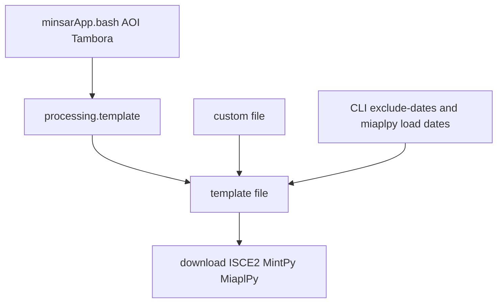

# Custom template options

Shared processing defaults live in [`minsar/defaults/processing.template`](../minsar/defaults/processing.template). That file is the control file for a normal minsarApp run: looks, network, coherence, upload flags, and the other lines `create_template.py` copies. The name does not use the `minsar_template` or `insar_template` prefix, so it stays distinct from `minsar_template.cfg` and `minsar_template_defaults.cfg`, which remain the `auto` key list and the older INI fallbacks. `create_template.py` copies that file. It replaces the old `docs/dummy_miaplpy_1.template`. `job_defaults.cfg` and `queues.cfg` stay as they are. Per-dataset choices live in one sectioned text file owned by the user, outside the minsar git checkout. Known-bad bursts stay in [`minsar/exclusions/exclude_acquisitions.csv`](../minsar/exclusions/exclude_acquisitions.csv).

minsarApp, run_minsar.bash, and save_custom_options.py share one custom file.

Two ways to start a run stay available:

```bash
run_minsar.bash GalapagosSenA106
minsarApp.bash $TE/GalapagosSenA106.template
```

[`minsar/bin/run_minsar.bash`](../minsar/bin/run_minsar.bash) builds a template from the dummy file and the custom file. `$TE` stays the place for templates you maintain by hand. Passing that path uses the file that is already there.

## Format

Use a sectioned text file for custom options. Use CSV only for the exclusion table.

A dataset has a changing set of keys, and several values contain commas (`-8.326:-8.194,117.942:118.069`, `20141213,20260401`, `0.0008,0.0008`). A `dataset,key,value` CSV needs quoting on those fields and is harder to scan when one volcano has many lines. Headers plus `key = value` lines match the template files already in use. A line whose first non-whitespace character is `#` is a comment and is not applied, including a commented section header and a commented assignment such as `# miaplpy.timeseries.minTempCoh = 0.55`. Blank lines are ignored. A template value is one token, with no spaces. The launcher key `options` is the exception: its value is the rest of the line, so several minsarApp flags can sit on one line. Text after a `#` on an active assignment is a comment and is not part of the value.

The exclusion list is a different table: every row is `platform`, `relativeOrbit`, `date`, `lat_sn`, `note`, and a row matches any project whose orbit and latitude overlap. That stays CSV. Folding it into the custom file would tie a bad burst to a project name and drop the orbit-plus-latitude match that `burst_download.bash` uses before a template stem exists.

Per-dataset ISCE2 dates still belong in the custom file as `minsar.excludeDates`. That is the stack exclude (and the post-download delete), separate from the burst-download CSV.

## Match key

A section applies when its header is contained in the template stem (basename without `.template`). `[GalapagosSenA106]` matches `GalapagosSenA106.template` and `qqGalapagosSenA106.template`. The stem is also `PROJECT_NAME` and the work directory under `$SCRATCHDIR`.

When several headers are contained in the stem, the longest header wins. Two matching headers of the same length are an error. A stem that contains no header is left unchanged.

`create_template.py` names the file `{project}{orbit label}` (`Tambora` plus `SenD134` becomes `TamboraSenD134`). A header of `Tambora` matches that stem. A longer header `TamboraSenD134` wins when both exist.

## Where the custom file lives

`setup/environment.bash` sets `MINSAR_CUSTOM_OPTIONS` to [`minsar/defaults/sample_custom_template_options.txt`](../minsar/defaults/sample_custom_template_options.txt). Every line in that sample is commented until a section is written into it. `environment.bash` then sources `~/.minsar/user_env.bash` when that file exists. An export there replaces `MINSAR_CUSTOM_OPTIONS`, `USER_PREFERRED`, and the other user settings.

When `MINSAR_CUSTOM_OPTIONS` is unset or empty, the loader reads `custom_template_options` in `$HOME/.minsar/config.cfg`. A path that is set but missing is an error. With neither set, the template is left unchanged.

## Where template files live

Curated templates live in `$TE` (`$TEMPLATES`). `minsarApp.bash $TE/GalapagosSenA106.template` reads that path. An AOI command today changes directory to `$TE` and [`create_template.py`](../minsar/scripts/create_template.py) replaces `$TE/{project}{label}.template` with a new copy of the dummy template plus the AOI fields. An existing file in `$TE` is overwritten.

Generated templates live next to `$TE`. [`setup/environment.bash`](../setup/environment.bash) sets `TEMPLATES` to `${WORKDIR}/infiles/${USER_PREFERRED}/TEMPLATES` and `TE` to that same path. There is no second template directory today. Phase 3 adds the sibling directory and the short name:

```bash
export AUTO_TEMPLATES=${WORKDIR}/infiles/${USER_PREFERRED}/AUTO_TEMPLATES
export ATE=${AUTO_TEMPLATES}
```

A generated file is `$ATE/GalapagosSenA106.template`. `$ATE` is the directory you `cd` to, the same way `$TE` is. `AUTO` marks files written from the custom file. `run_minsar.bash` reads and writes only `$ATE`. It does not read or write `$TE`, including `$TE/log`.

The AOI form of `minsarApp.bash` accepts `--template-dir DIR` when one command should write somewhere else. Without the flag, AOI mode keeps writing `$TE` as it does now. `run_minsar.bash` always passes `--template-dir $ATE`. With that flag, the AOI bridge changes to `$ATE` and appends its command log there. A file already in `$ATE` is replaced from the dummy template, the AOI, and the custom section.

```bash
minsarApp.bash -8.326:-8.194,117.942:118.069 Tambora --flight-dir desc --template-dir $ATE
```

`minsarApp.bash $TE/GalapagosSenA106.template` does not re-read the dummy file. Phase 1 still refreshes the custom block at the end of that file. Other lines in the `$TE` template stay as they are.

## What an AOI command already does

```bash
minsarApp.bash -8.326:-8.194,117.942:118.069 Tambora --flight-dir desc
```

[`minsar/scripts/create_template.py`](../minsar/scripts/create_template.py) copies [`minsar/defaults/processing.template`](../minsar/defaults/processing.template) and replaces `ssaraopt.relativeOrbit`, `miaplpy.subset.lalo`, dates, and `topsStack.coregistration` from the AOI and coverage. Looks, network, coherence defaults, upload flags, and the other lines in the defaults file are kept. Orbit and subset values that are only examples in that file are not left on Tambora.

A change in `processing.template` applies to the next run that copies that file. An AOI command that writes a template, and every `run_minsar.bash` run, copy the file as it is now, then the custom section overrides any key it lists. `minsarApp.bash $TE/GalapagosSenA106.template` does not read the defaults file, so an existing `$TE` template keeps its own lines. A value already saved in the custom file keeps winning after the defaults file changes, including when that saved value was the old default.

## Optional later — dated copies of the defaults file

Not part of phases 1–4. Those phases always copy `minsar/defaults/processing.template`. That active name stays free of a date or a version number.

When this option is added, an edit of the active file first copies the current contents to `minsar/defaults/archive/processing_YYYYMMDD.template`. A second edit on the same day uses `processing_YYYYMMDD_HHMM.template`. The archive name is the retired copy. New runs still read the undated active file.

The custom section can record which copy was current when the section was saved. `defaults` is a launcher key. It is not written into the processing template.

```text
[GalapagosSenA106]
defaults = 20261112
aoi = -1.6:1.7,-92.0:-89.0
mintpy.unwrapError.method = bridging+phase_closure
```

`save_custom_options.py` would set `defaults` to the archive date of the file it compared against. `run_minsar.bash` would keep using the active file unless that dataset's `defaults` value, or a `--defaults YYYYMMDD` flag, names an archive. The archive is then the file that gets copied for that run, and the custom section still overrides keys it lists.

Phase 1 adds the custom-file overlay on that written template before ISCE2, MintPy, and MiaplPy run.

## Phase 1 — apply custom keys

The user's file, not the example:

```text
[GalapagosSenA106]
mintpy.unwrapError.method = bridging+phase_closure

# [GalapagosSenD128]
# minsar.excludeDates = 20141213
# miaplpy.timeseries.minTempCoh = 0.55
# mintpy.networkInversion.minTempCoh = 0.7
```

Allowed template prefixes: `mintpy.`, `miaplpy.`, `minsar.`, `topsStack.`, `ssaraopt.`. A duplicate section name is an error. In the user's file the Galapagos unwrap line is active. Date and coherence lines stay commented until real values are filled in. The committed example has every line commented.

[`minsar/bin/minsarApp.bash`](../minsar/bin/minsarApp.bash) calls [`minsar/utils/custom_template_options.py`](../minsar/utils/custom_template_options.py) after argument parsing and before the existing CLI patches (`--exclude-dates`, `--miaplpy.load.startDate`, `--miaplpy.load.endDate`). The loader uses the lookup order above. CLI flags still win for that run. The loader is executable and has `--help`.

The loader selects the longest section header contained in the template stem. It rewrites a marked block at the beginning of the template on every run:

```text
# BEGIN custom_template_options
mintpy.unwrapError.method = bridging+phase_closure
# END custom_template_options
```

The same key later in the file is commented with a `# custom_template_options:` prefix, because `create_template_array` and MintPy keep the last active line. Replacing the whole block each run updates a threshold. A key removed from the custom file is restored from that commented line.

`minsar.excludeDates` or `topsStack.excludeDates` in that section is written with `apply_exclude_dates_to_template` (`merge=False`) so both keys become that date list. Dates that exist only in the template are not kept.

Launcher keys `aoi` and `options` are not written into the block.

Applied keys are printed into the project log. `smallbaselineApp.py`, MiaplPy jobfiles, and `create_runfiles.py` already receive the template path. Scope is `minsarApp.bash` (the AOI bridge included, because it re-execs `minsarApp.bash` on the written template).



Smoke check: loader `--help`, and a temp copy of a template whose stem is `qqGalapagosSenA106` receives the `GalapagosSenA106` unwrap line. No new tests. No architecture docs. No change to `exclude_acquisitions.csv` or `minsarIsce3App.bash`.

## Phase 2 — AOI in the same file

The dataset name already carries the project and the flight direction. `TamboraSenD134` is project `Tambora`, descending orbit 134. `GalapagosSenA106` is project `Galapagos`, ascending orbit 106. `SenA` is ascending and `SenD` is descending, including the older `SenAT` and `SenDT` spellings. The same labels are what [`get_sar_coverage.py`](../minsar/scripts/get_sar_coverage.py) writes (`SenA29`, `SenD36`) and what `create_template.py` appends to the project name.

The custom file stores the coordinates as `aoi` (`S:N,W:E`). It is a launcher key.

```text
[TamboraSenD134]
aoi = -8.326:-8.194,117.942:118.069

[GalapagosSenA106]
aoi = -1.6:1.7,-92.0:-89.0
mintpy.unwrapError.method = bridging+phase_closure
```

## Phase 3 — run_minsar.bash and --template-dir

```bash
run_minsar.bash GalapagosSenD128 GalapagosSenA106 TamboraSenD134 CerroAzulSenA106
```

Each section may also set `options`, the extra `minsarApp.bash` arguments for that dataset only. A missing or commented `options` line adds no extra flags.

```text
[CerroAzulSenA106]
aoi = S:N,W:E
options = --no-mintpy --miaplpy

[GalapagosSenA106]
aoi = -1.6:1.7,-92.0:-89.0
mintpy.unwrapError.method = bridging+phase_closure
```

For each argument, parse the project and flight direction from the name, select the longest matching section, read `aoi` and `options`, and run the AOI command with `--template-dir $ATE`:

```bash
minsarApp.bash S:N,W:E CerroAzul --flight-dir asc --template-dir $ATE --no-mintpy --miaplpy
minsarApp.bash -1.6:1.7,-92.0:-89.0 Galapagos --flight-dir asc --template-dir $ATE
```

Those flags match `minsarApp.bash CerroAzulSenA106.template --no-mintpy --miaplpy` and `minsarApp.bash $TE/GalapagosSenA106.template`. `TamboraSenD134` parses as project `Tambora` and `--flight-dir desc`. `qqGalapagosSenA106` parses as project `qqGalapagos` and `--flight-dir asc`, and takes `aoi` and `options` from section `GalapagosSenA106` when that header is the longest one contained in the name. A name without `SenA` or `SenD`, or a match with no `aoi`, is an error.

Flags between one dataset name and the next name apply only to that dataset. They are appended after that section's `options` and passed through to `minsarApp.bash`, which already sends `--start-date` to `create_template` (`ssaraopt.startDate`, `YYYYMMDD` or `YYYY-MM-DD`).

```bash
run_minsar.bash GalapagosSenA106 --start-date 20260101
run_minsar.bash GalapagosSenA106 --start-date 20260101 CerroAzulSenA106 --no-mintpy --miaplpy
```

The first command runs only Galapagos and sets the start date on `$ATE/GalapagosSenA106.template`. It does not write `$TE`. The second sets the start date only on Galapagos; Cerro Azul gets `--no-mintpy --miaplpy` for that invocation, in addition to any `options` line in its section. A `--` on the `run_minsar.bash` command means the flags after it go to every dataset, after that dataset's own flags.

If `$ATE/<stem>.template` already exists, `run_minsar.bash` replaces it. `run_minsar.bash` does not look at `$TE` at all. To process from a curated template, run `minsarApp.bash $TE/<stem>.template` yourself.

## Phase 4 — save a finished $TE template into the custom file

A new dataset starts in `$TE`, where the template can be edited and the run repeated:

```bash
minsarApp.bash -8.326:-8.194,117.942:118.069 Tambora --flight-dir desc
```

That writes `$TE/TamboraSenD134.template` and processes it. Change keys in that file, or pass flags on later `minsarApp.bash $TE/TamboraSenD134.template` runs, until the result is right.

Then [`minsar/scripts/save_custom_options.py`](../minsar/scripts/save_custom_options.py) copies the settled choices into the user's custom file. It is Python so the comparison is by key, not by line layout. It is executable and has `--help`.

```bash
save_custom_options.py $TE/TamboraSenD134.template
```

Both files are read as assignments. A `#` line is ignored. Text after `#` on an assignment is ignored. Extra spaces around `=` do not matter. The last uncommented assignment for a key wins. Key order in `$TE` does not have to match `processing.template`.

The section name is the template stem. The script replaces that section if it is already present. It writes `aoi` from `miaplpy.subset.lalo` and every template key whose value differs from [`minsar/defaults/processing.template`](../minsar/defaults/processing.template). Orbit, dates, and subset lines that `create_template` fills on every AOI run are not copied when they match that generated result. The custom-file path is `MINSAR_CUSTOM_OPTIONS` (the sample file unless `~/.minsar/user_env.bash` sets another path).

`minsarApp` flags such as `--no-mintpy` are not stored in the template. Pass them to the save script to set the `options` line:

```bash
save_custom_options.py $TE/CerroAzulSenA106.template -- --no-mintpy --miaplpy
```

After that, `run_minsar.bash TamboraSenD134` uses `$ATE` and the saved section. `$TE/TamboraSenD134.template` stays where it is.

## Phase 1 also removes the old template generators

`minsarApp.bash` does not call `create_insar_template.py`. An AOI command uses `create_template.py` and `processing.template`. Nothing in the tests imports `create_insar_template`. Phase 1 deletes these files so the old skeletons are not mistaken for `processing.template`:

- `minsar/defaults/insar_template.template`
- `minsar/utils/create_insar_template.py`
- `minsar/src/minsar/cli/create_insar_template.py`
- `minsar/docs/template.txt` — the `***marker***` skeleton that CLI looks for (`docs/template.txt` under the repo, `MakeTemplate/docs/template.txt`, or `minsar/docs/template.txt`)

## Acquisition exclusions stay in the CSV

[`minsar/exclusions/exclude_acquisitions.csv`](../minsar/exclusions/exclude_acquisitions.csv) stays the download filter. `burst_download.bash` drops a date when platform, relative orbit, and latitude overlap match, for whatever the project is called. That still covers a run whose name does not contain a custom-file header.

A date list that belongs to one dataset is `minsar.excludeDates` in the custom file. Phase 1 writes that into the template, so ISCE2 skips those scenes and `minsarApp.bash` deletes them after download. `qqGalapagosSenA106` picks that list up because `GalapagosSenA106` is contained in the stem. It does not replace the CSV.
