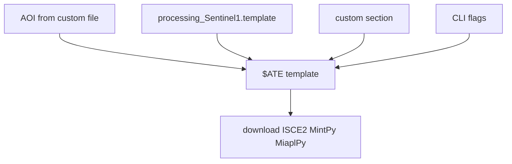

# Custom template options

Shared defaults live in [`minsar/defaults/processing_Sentinel1.template`](../minsar/defaults/processing_Sentinel1.template) and [`minsar/defaults/processing_Alos2.template`](../minsar/defaults/processing_Alos2.template). `create_template.py` copies the one for the platform (`--platform ALOS2` selects the ALOS-2 file). Per-dataset choices live in one sectioned text file owned by the user, outside the git checkout. Known-bad bursts stay in [`minsar/exclusions/exclude_acquisitions.csv`](../minsar/exclusions/exclude_acquisitions.csv).

Two ways to start a run:

```bash
run_minsar.bash GalapagosSenA106
minsarApp.bash $TE/GalapagosSenA106.template
```

`run_minsar.bash` generates `$ATE/GalapagosSenA106.template` from the defaults file, the AOI and the custom section, then processes it. `$TE` holds hand-maintained templates; `run_minsar.bash` never reads or writes it, and the custom file is never applied to it.

## Custom file

Sectioned text, `key = value` lines, one section per dataset:

```text
[GalapagosSenA106]
aoi = -1.6:1.7,-92.0:-89.0
mintpy.unwrapError.method = bridging+phase_closure

# [GalapagosSenD128]
# minsar.excludeDates = 20141213
```

- Lines starting with `#` and blank lines are ignored. Text after `#` on an assignment is a comment.
- A value is one token.
- Allowed template prefixes: `mintpy.`, `miaplpy.`, `minsar.`, `topsStack.`, `stripmapStack.`, `alos2Stack.`, `asf.`, `ssaraopt.`. Key names are checked.
- `aoi` (`S:N,W:E`) is a launcher key: it feeds the AOI command and is not written into the template.
- minsarApp flags (`--miaplpy`, `--queue`, ...) do not belong in the file; give them on the command line.
- A duplicate section name is an error.

**Match key.** A section applies when its header is contained in the template stem (`[GalapagosSenA106]` matches `qqGalapagosSenA106.template`). The longest header wins; equal-length matches are an error; no match leaves the template unchanged.

**Location.** `setup/environment.bash` sets `MINSAR_CUSTOM_OPTIONS` to [`sample_custom_template_options.txt`](../minsar/defaults/sample_custom_template_options.txt) (all lines commented), then sources `~/.minsar/user_env.bash`, where an export can override it. If unset, the loader reads `custom_template_options` in `$HOME/.minsar/config.cfg`. A set but missing path is an error.

**Exclusions.** The CSV (`platform, relativeOrbit, date, lat_sn, note`) stays the download filter and matches by orbit and latitude, independent of project name. A per-dataset date list is `minsar.excludeDates` in the custom file; it is written into the template so ISCE2 skips those scenes and `minsarApp.bash` deletes them after download.

## Template directories

`TE` is `${WORKDIR}/infiles/${USER_PREFERRED}/TEMPLATES`. Generated templates go to a sibling directory:

```bash
export AUTO_TEMPLATES=${WORKDIR}/infiles/${USER_PREFERRED}/AUTO_TEMPLATES
export ATE=${AUTO_TEMPLATES}
```

The AOI form of `minsarApp.bash` writes the template and its command log in `$ATE`, replacing an existing file. `--template-dir DIR` writes somewhere else.

```bash
minsarApp.bash -8.326:-8.194,117.942:118.069 Tambora --flight-dir desc
```

## Building a template in $ATE

1. [`create_template.py`](../minsar/scripts/create_template.py) copies `processing_Sentinel1.template` (or `processing_Alos2.template`) and fills `asf.relativeOrbit`, `miaplpy.subset.lalo`, the dates and `topsStack.coregistration` from the AOI and coverage. The file is named `{project}{orbit label}` (`TamboraSenD134`). `SenA`/`SenD` (also `SenAT`/`SenDT`) give the flight direction.
2. [`minsarApp.bash`](../minsar/bin/minsarApp.bash) calls [`custom_template_options.py`](../minsar/utils/custom_template_options.py) `apply` when `AUTO_TEMPLATE` is in the template path. The custom keys are written at the top of the template between `##### Begin custom options` and `##### End custom options`. Every active line of those keys in the part copied from the defaults file is deleted, so each key appears once. Commented lines are left alone. `minsar.excludeDates` or `topsStack.excludeDates` writes both keys at the top with the same normalized date list. Applied keys are printed to the project log.

```text
##### Begin custom options
minsar.excludeDates = 20141213,20260401
topsStack.excludeDates = 20141213,20260401
mintpy.unwrapError.method = bridging+phase_closure
##### End custom options
##### copied from processing_Sentinel1.template, without those keys
```
3. The CLI patches (`--exclude-dates`, `--start-date`, `--miaplpy.load.startDate`, `--<key> value`, ...) run after this, so CLI flags win for that run.

Default dates come from the defaults file: `asf.startDate = 20141001`, `asf.endDate = auto` (latest acquisition), `miaplpy.load.startDate/endDate = auto`. A custom key or a command-line flag replaces them.



## run_minsar.bash

```bash
run_minsar.bash GalapagosSenD128 GalapagosSenA106 TamboraSenD134
```

[`run_minsar.bash`](../minsar/bin/run_minsar.bash) passes its arguments to `custom_template_options.py plan`. For each name it parses project and flight direction (`TamboraSenD134` → `Tambora`, `--flight-dir desc`), selects the longest matching section, reads `aoi`, and runs:

```bash
minsarApp.bash -1.6:1.7,-92.0:-89.0 Galapagos --flight-dir asc --template-dir $ATE
```

- A dataset argument may carry a path and a `.template` suffix (`$TE/GalapagosSenA106.template`); only the stem is used.
- A name without `SenA`/`SenD`, no matching section, or a section with no `aoi` is an error.
- `qqGalapagosSenA106` parses as project `qqGalapagos` and takes `aoi` from `GalapagosSenA106`.
- Flags after a dataset name apply only to it. Flags after `--` apply to every dataset, after its own flags.
- `$ATE` and `$TE` must differ. Each command is logged to `$ATE/log`.

```bash
run_minsar.bash GalapagosSenA106 --start-date 20260101 CerroAzulSenA106 --no-mintpy --miaplpy
```

## save_custom_options.py

A new dataset can start in `$TE`; edit the template and rerun until the result is right. Then:

```bash
save_custom_options.py $TE/TamboraSenD134.template
```

[`save_custom_options.py`](../minsar/scripts/save_custom_options.py) compares assignments by key with `processing_Sentinel1.template` or `processing_Alos2.template` (last uncommented line wins; `#` text and spacing ignored) and replaces the section named by the template stem. It writes `aoi` from `miaplpy.subset.lalo` (or `mintpy.subset.lalo`) and every key that differs from the defaults file. Keys that `create_template` regenerates on each AOI run (`asf.relativeOrbit`, `asf.startDate`, `asf.endDate`, `topsStack.coregistration`, `alos2Stack.boundingBox`, `mintpy.plot`) are not saved. The target is `MINSAR_CUSTOM_OPTIONS`. Afterwards `run_minsar.bash TamboraSenD134` builds `$ATE/TamboraSenD134.template` from the saved section.

## Optional later: dated copies of the defaults files

An edit of a defaults file first archives the old contents to `minsar/defaults/archive/processing_Sentinel1_YYYYMMDD.template` (`_HHMM` suffix for a second edit the same day). A custom section may pin an archive with the launcher key `defaults = 20261112`, or a run may pass `--defaults YYYYMMDD`; that archive is then the copied file. Otherwise the active file is used.
