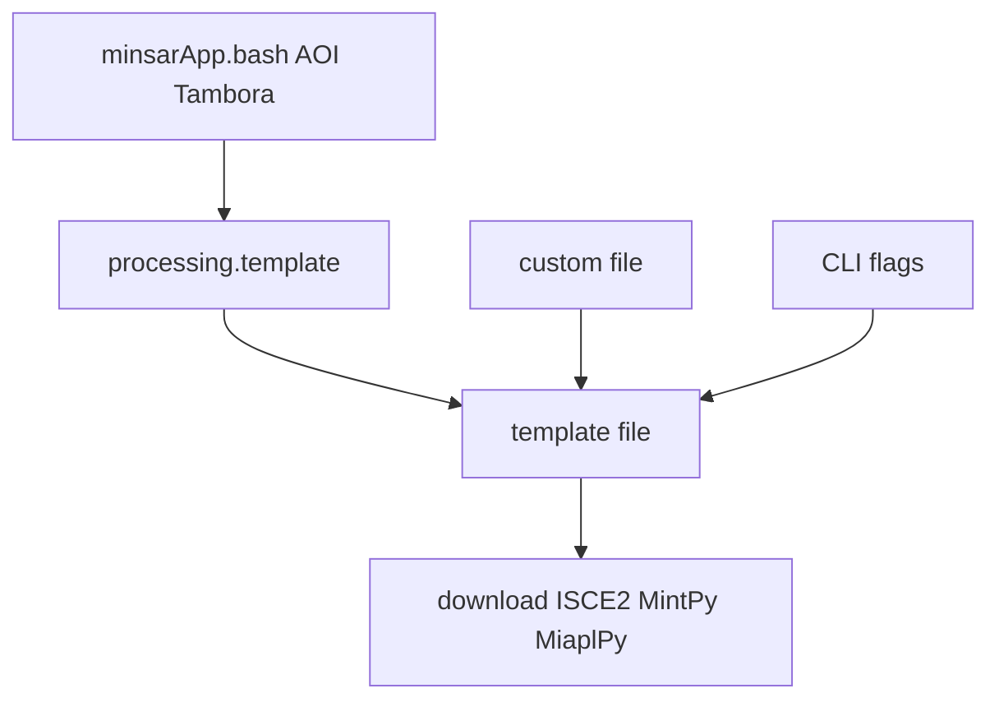

# Custom template options

Shared defaults live in [`minsar/defaults/processing.template`](../minsar/defaults/processing.template); `create_template.py` copies it for every new template. Per-dataset choices live in one sectioned text file owned by the user, outside the git checkout. Known-bad bursts stay in [`minsar/exclusions/exclude_acquisitions.csv`](../minsar/exclusions/exclude_acquisitions.csv). `minsarApp.bash`, `run_minsar.bash` and `save_custom_options.py` share the custom file.

Two ways to start a run:

```bash
run_minsar.bash GalapagosSenA106
minsarApp.bash $TE/GalapagosSenA106.template
```

`run_minsar.bash` builds a template in `$ATE` from the defaults file and the custom file. `$TE` holds hand-maintained templates and is never read or written by `run_minsar.bash`.

## Custom file

Sectioned text, `key = value` lines, one section per dataset:

```text
[GalapagosSenA106]
aoi = -1.6:1.7,-92.0:-89.0
mintpy.unwrapError.method = bridging+phase_closure

# [GalapagosSenD128]
# minsar.excludeDates = 20141213
```

- Lines starting with `#` and blank lines are ignored. Text after `#` on an assignment is a comment.
- A value is one token. The launcher key `options` takes the rest of the line (several minsarApp flags).
- Allowed template prefixes: `mintpy.`, `miaplpy.`, `minsar.`, `topsStack.`, `stripmapStack.`, `alos2Stack.`, `asf.`, `ssaraopt.`.
- Launcher keys `aoi` (`S:N,W:E`) and `options` are not written into templates.
- A duplicate section name is an error.

**Match key.** A section applies when its header is contained in the template stem (`[GalapagosSenA106]` matches `qqGalapagosSenA106.template`). The longest header wins; equal-length matches are an error; no match leaves the template unchanged.

**Location.** `setup/environment.bash` sets `MINSAR_CUSTOM_OPTIONS` to [`sample_custom_template_options.txt`](../minsar/defaults/sample_custom_template_options.txt) (all lines commented), then sources `~/.minsar/user_env.bash`, where an export can override it. If unset, the loader reads `custom_template_options` in `$HOME/.minsar/config.cfg`. A set but missing path is an error.

**Exclusions.** The CSV (`platform, relativeOrbit, date, lat_sn, note`) stays the download filter and matches by orbit and latitude, independent of project name. A per-dataset date list is `minsar.excludeDates` in the custom file; it is written into the template so ISCE2 skips those scenes and `minsarApp.bash` deletes them after download.

## Template directories

`TE` is `${WORKDIR}/infiles/${USER_PREFERRED}/TEMPLATES`. Generated templates go to a sibling directory:

```bash
export AUTO_TEMPLATES=${WORKDIR}/infiles/${USER_PREFERRED}/AUTO_TEMPLATES
export ATE=${AUTO_TEMPLATES}
```

The AOI form of `minsarApp.bash` accepts `--template-dir DIR` (default `$TE`). `run_minsar.bash` always passes `--template-dir $ATE`; the AOI bridge then writes the template and its command log there, replacing any existing file.

```bash
minsarApp.bash -8.326:-8.194,117.942:118.069 Tambora --flight-dir desc --template-dir $ATE
```

## AOI command

[`create_template.py`](../minsar/scripts/create_template.py) copies `processing.template` and replaces `asf.relativeOrbit`, `miaplpy.subset.lalo`, dates and `topsStack.coregistration` from the AOI and coverage. The file is named `{project}{orbit label}` (`TamboraSenD134`). `SenA`/`SenD` (also `SenAT`/`SenDT`) give the flight direction.

`minsarApp.bash $TE/X.template` uses the file as it is: neither the defaults file nor the custom file is applied. A saved custom value keeps winning after the defaults change because it is re-applied on each generation.

## Applying custom keys

When a template is generated (AOI mode, including every `run_minsar.bash` run), [`custom_template_options.py`](../minsar/utils/custom_template_options.py) builds it from `processing.template`, the AOI fields and the matching custom section. Each custom key replaces every existing line of that key in the copied defaults, so the key appears once, with the custom value. Keys not in the defaults are appended. No markers, no commented-out lines.

```text
mintpy.unwrapError.method = bridging+phase_closure
```

`minsar.excludeDates` or `topsStack.excludeDates` is written with `apply_exclude_dates_to_template` (`merge=False`), so both keys get that list. Applied keys are printed to the project log. The CLI patches (`--exclude-dates`, `--miaplpy.load.startDate`, `--miaplpy.load.endDate`) run after this, so CLI flags win for that run.



## run_minsar.bash

```bash
run_minsar.bash GalapagosSenD128 GalapagosSenA106 TamboraSenD134
```

For each name: parse project and flight direction (`TamboraSenD134` → `Tambora`, `--flight-dir desc`), select the longest matching section, read `aoi` and `options`, and run:

```bash
minsarApp.bash -1.6:1.7,-92.0:-89.0 Galapagos --flight-dir asc --template-dir $ATE
```

A name without `SenA`/`SenD`, or a match with no `aoi`, is an error. `qqGalapagosSenA106` parses as project `qqGalapagos` and takes `aoi` and `options` from `GalapagosSenA106`.

Flags after a dataset name apply only to it and are passed to `minsarApp.bash`. Flags after `--` apply to every dataset, after its own flags.

```bash
run_minsar.bash GalapagosSenA106 --start-date 20260101 CerroAzulSenA106 --no-mintpy --miaplpy
```

## save_custom_options.py

A new dataset starts in `$TE`; edit the template and rerun until the result is right. Then:

```bash
save_custom_options.py $TE/TamboraSenD134.template
```

[`save_custom_options.py`](../minsar/scripts/save_custom_options.py) compares assignments by key (last uncommented line wins; `#` text and spacing ignored) and replaces the section named by the template stem. It writes `aoi` from `miaplpy.subset.lalo` and every key that differs from `processing.template`. Orbit, date and subset lines that `create_template` regenerates on each AOI run are skipped when they match. The target is `MINSAR_CUSTOM_OPTIONS`. Afterwards `run_minsar.bash TamboraSenD134` uses `$ATE` and the saved section.

## Removed template generators

`minsarApp.bash` does not call `create_insar_template.py`. These files are deleted so they are not mistaken for `processing.template`:

- `minsar/defaults/insar_template.template`
- `minsar/utils/create_insar_template.py`
- `minsar/src/minsar/cli/create_insar_template.py`
- `minsar/docs/template.txt`

## Optional later: dated copies of the defaults file

An edit of `processing.template` first archives the old contents to `minsar/defaults/archive/processing_YYYYMMDD.template` (`_HHMM` suffix for a second edit the same day). A custom section may pin an archive with the launcher key `defaults = 20261112`, or a run may pass `--defaults YYYYMMDD`; that archive is then the copied file. Otherwise the active file is used.
